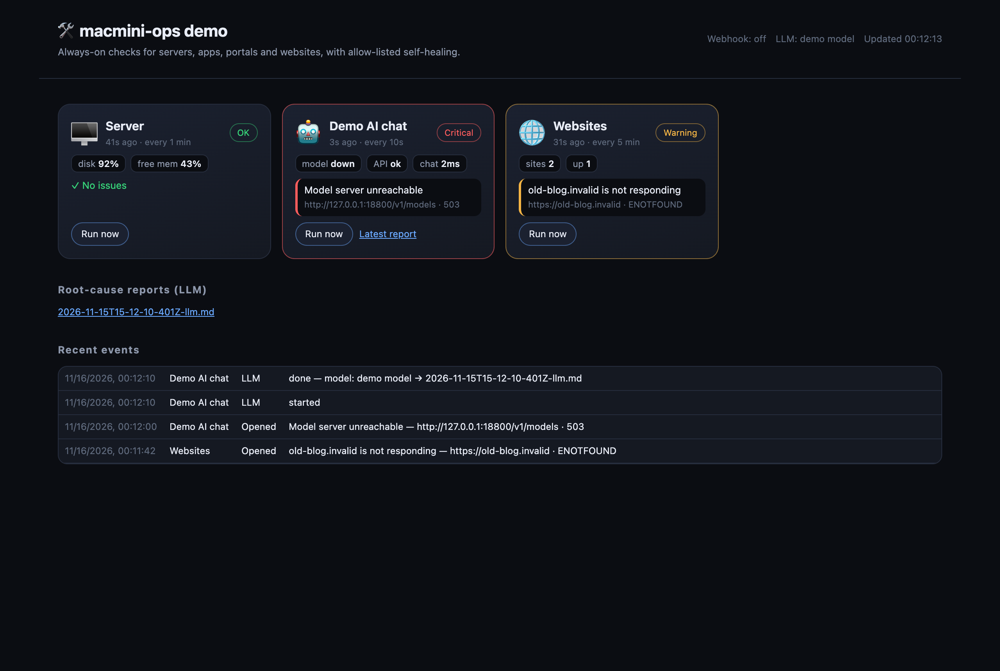

<div align="center">

# 🛠️ macmini-ops

**사무실 Mac mini를 지키는 상시 운영 에이전트.**
서비스를 지켜보다가 허용된 범위에서는 스스로 고치고, 고칠 수 없는 문제는 LLM이 원인을 설명합니다.

[English](README.md) · [문서](docs/) · [기여 안내](CONTRIBUTING.md)



</div>

## 왜 만들었나

작은 팀은 책상 밑 Mac mini에서 실제 업무 서비스를 돌립니다. 사내 AI 채팅, 포탈, launchd 서비스 몇 개, GPU 서버로 가는 SSH 터널 같은 것들입니다. 본격적인 모니터링 스택은 과하고, 단순한 접속 확인으로는 터널을 다시 잇지도 못하고 *왜* 고장 났는지도 알려주지 않습니다.

macmini-ops는 Node.js 데몬 하나로 이렇게 동작합니다.

- **점검**: 정해진 주기에 규칙대로 확인합니다. 이 단계에는 AI가 끼지 않습니다.
- **자동 복구**: 허용 목록에 있는 대상만, 대상별로 정한 간격에 한 번만 조치합니다. 전체를 보고만 하는 모드로 둘 수도 있습니다.
- **원인 설명**: 심각한 문제가 이어지면 LLM이 수집된 증거를 읽고 보고서를 씁니다. LLM은 **읽기만** 하고 아무것도 실행하지 않습니다.
- **사내 모델 우선**: OpenAI 호환 서버(vLLM, Ollama, LM Studio)를 먼저 쓰고, 안 되면 Codex CLI 같은 다음 백엔드로 넘어갑니다.
- **의존성 0**: Node.js 20 이상만 있으면 됩니다. 설치할 패키지도, 빌드 단계도 없습니다.

## 1분 데모

```bash
git clone https://github.com/baryonlabs/macmini-ops.git && cd macmini-ops
npm run demo        # http://127.0.0.1:8095
```

데모는 가짜 서비스를 띄워 인터넷 없이 돌아갑니다. 25초 뒤 가짜 모델 서버가 멈추고 95초에 돌아오므로, 장애 발생 → LLM 보고서 → 복구 흐름을 그대로 볼 수 있습니다.

## 시작하기

```bash
cp config.example.json config.json   # 우리 서비스에 맞게 수정
node opsd.mjs once server            # 한 에이전트만 한 번 돌려 보기
./deploy/install-macos.sh            # launchd 상시 실행 → http://127.0.0.1:8095
```

예시 설정은 **보고만 하는 모드**(`dryRun`)로 시작합니다. 결과를 믿을 수 있게 되면 `remediation.dryRun`을 `false`로 바꾸세요. 화면과 메시지를 한국어로 보려면 설정에 `"locale": "ko"`를 넣으세요.

## 에이전트 종류

| type | 점검 | 자동 조치 |
|---|---|---|
| `host` | launchd 서비스, 디스크, 메모리, Docker, Tailscale | 꺼진 서비스 `launchctl kickstart` |
| `llm-app` | OpenAI 호환 모델 서버(SSH 터널 포함), 앱 API·웹, 주기적 실제 채팅 | 터널 재시작, `docker compose up -d` |
| `team-portal` | [team-portal](https://github.com/baryonlabs/team-portal), fallback 사이트, 공개 주소, 카드 링크 | 포탈 재시작, `tailscale serve` 재연결 |
| `sites` | 웹사이트 접속 여부, TLS 인증서 만료일 | 없음 (보고만) |
| *직접 만든 종류* | 무엇이든 | 같은 허용 목록 규칙 아래에서 |

새 종류는 파일 하나로 추가할 수 있습니다: [docs/writing-agents.md](docs/writing-agents.md)

## 회사 정보와 비밀은 저장소 밖에

| 무엇 | 어디에 |
|---|---|
| 서비스 이름, 주소, 경로, 사이트 목록 | `config.json` (git이 무시함. 회사의 비공개 저장소에서 관리) |
| LLM에게 줄 회사 고유의 운영 지식 | 각 에이전트 설정의 `playbook` |
| 비밀 | `OPS_WEBHOOK_URL` 환경변수, `~/.macmini-ops/token` (자동 생성, 권한 600) |

## 라이선스

[MIT](LICENSE) © Baryon Labs
