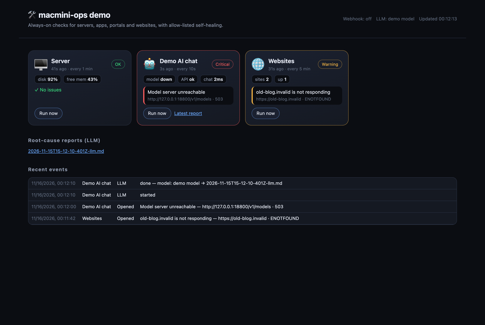
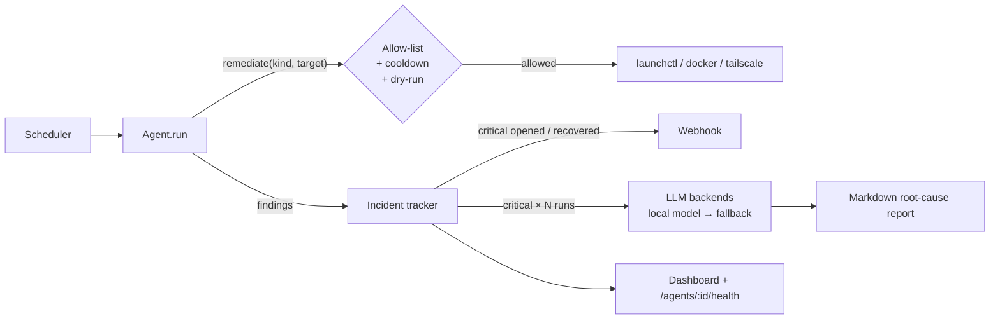

<div align="center">

# 🛠️ macmini-ops

**Always-on ops agents for the Mac mini in your office.**
They watch your services, fix what they are allowed to fix, and ask an LLM to explain what they can't.

[](https://github.com/baryonlabs/macmini-ops/actions/workflows/ci.yml)
[](https://github.com/baryonlabs/macmini-ops/actions/workflows/codeql.yml)
[](https://scorecard.dev/viewer/?uri=github.com/baryonlabs/macmini-ops)
[](https://github.com/baryonlabs/macmini-ops/releases)
[](LICENSE)


[Quick start](#quick-start) · [Demo](#try-the-demo-in-one-minute) · [Agent types](#agent-types) · [Docs](docs/) · [한국어](README.ko.md)



</div>

## Why

Small teams run real workloads on a Mac mini under a desk: an internal AI chat, a portal, a few launchd services, an SSH tunnel to a GPU box. Full monitoring stacks are overkill, and plain uptime checks can't restart a tunnel or tell you *why* something broke.

macmini-ops is one small Node.js daemon that:

- **Checks** services on a schedule, using plain rules with no AI in the loop.
- **Self-heals** within an explicit allow-list, at most once per target per cooldown window, with a global dry-run switch.
- **Explains** persistent critical incidents. An LLM reads the collected evidence and writes a root-cause report. It runs **read-only**: it never executes anything.
- **Prefers your own model**: any OpenAI-compatible server (vLLM, Ollama, LM Studio) first, then falls back to the next backend, such as Codex CLI.
- **Has zero dependencies**: Node.js ≥ 20, no `npm install`, no build step.

## Try the demo in one minute

```bash
git clone https://github.com/baryonlabs/macmini-ops.git && cd macmini-ops
npm run demo        # open http://127.0.0.1:8095
```

The demo starts mock services and runs fully offline. The mock model server goes down at +25 s and comes back at +95 s, so you can watch an incident open, an LLM report appear and the incident recover.

## Quick start

```bash
cp config.example.json config.json   # describe your services
node opsd.mjs once server            # run one agent once and print what it found
./deploy/install-macos.sh            # run it forever under launchd → http://127.0.0.1:8095
```

`config.example.json` starts in **dry-run** mode, so the agents report what they *would* fix. Set `remediation.dryRun` to `false` once you trust them.

## Agent types

| type | Watches | Allowed self-healing |
|---|---|---|
| `host` | launchd services, disk, memory, Docker Desktop, Tailscale | `launchctl kickstart` stopped services |
| `llm-app` | OpenAI-compatible model server (optionally behind an SSH tunnel), app API and web, periodic real chat | restart the tunnel, `docker compose up -d` |
| `team-portal` | a [team-portal](https://github.com/baryonlabs/team-portal), its fallback site, the public URL, every card link | restart the portal, re-apply `tailscale serve` |
| `sites` | website reachability, TLS certificate expiry | none (report only) |
| *your own* | anything | whatever you implement, gated by the same allow-list |

You can use the same type more than once, for example two `llm-app` agents for two model servers. Writing a new type takes one small file: see [docs/writing-agents.md](docs/writing-agents.md).

## How it works



More detail is in [docs/architecture.md](docs/architecture.md).

## Keep your company's details out of the repo

The engine is generic. Everything specific to your organization lives outside it:

| What | Where |
|---|---|
| Service labels, hosts, paths, site lists | `config.json`, which is git-ignored. Keep it in your own private repo. |
| Company-specific knowledge for the LLM | Each agent's `playbook` field in config |
| Secrets | `OPS_WEBHOOK_URL` env var (written only to a mode-600 launchd plist) and `~/.macmini-ops/token` (generated, mode 600) |

## Dashboard & API

| Endpoint | |
|---|---|
| `GET /` | Dashboard (English / 한국어 via `"locale"`) |
| `GET /api/agents` | Full state as JSON |
| `GET /agents/:id/health` | `503` while the agent has a critical finding. Point any uptime checker or a team-portal card at it. |
| `GET /reports/:file` | LLM root-cause reports |
| `POST /api/agents/:id/run` | Run an agent now (Bearer token) |

## Roadmap

- Linux `host` agent (systemd)
- Prometheus `/metrics`
- Slack / Discord message formatting with action buttons
- MCP server so AI assistants can query state and trigger runs

Have an idea? [Open a discussion](https://github.com/baryonlabs/macmini-ops/discussions). Want to help? Look for [`good first issue`](https://github.com/baryonlabs/macmini-ops/labels/good%20first%20issue).

## Contributing

PRs are welcome. Please read [CONTRIBUTING.md](CONTRIBUTING.md) and our [Code of Conduct](CODE_OF_CONDUCT.md). Report security issues privately as described in [SECURITY.md](SECURITY.md).

## License

[MIT](LICENSE) © Baryon Labs
